  <picture>
    <source media="(prefers-color-scheme: dark)" srcset="./assets/hero-dark.svg" />
    <source media="(prefers-color-scheme: light)" srcset="./assets/hero-light.svg" />
    
  </picture>

  

  
  
  

  <picture>
    <source media="(prefers-color-scheme: dark)" srcset="./assets/card-dark.svg" />
    <source media="(prefers-color-scheme: light)" srcset="./assets/card-light.svg" />
    
  </picture>

---

### 🎧 关于我 / About Me

平时喜欢把不好用的软件自己重写一遍，尤其执着于**界面干净**、**交互顺手**和**声音好听**。  
主力时间在写桌面端与全栈 TypeScript，也会顺手捣鼓移动端配套、博客工作台、二次元图床 API 和聊天机器人插件。

- 💿 最近几乎全天都在打磨 **[Aria](https://github.com/YRRLYB/Aria)** —— 把本地无损、网易云、QQ 音乐、B站和 YouTube 塞进同一张桌面。
- 📱 顺带给它配了安卓端 **[Aria-Mobile](https://github.com/YRRLYB/Aria-Mobile)**，出门也能接着同一条队列往下听。
- ✨ 偏爱黑白灰搭配克制的紫色荧光，加一点不吵闹的实时频谱和动效。
- 🧭 坐标：**你猜我在哪** · 遇到有意思的坑欢迎来仓库聊几句。

---

### 🛠️ 常用工具箱 / Tech Stack

  
  
  
  
  
  
   
  
  
  
  

---

### ✨ 在做的项目 / Featured Work

<table width="100%">
  <tr>
    <td width="50%" valign="top">
      <a href="https://github.com/YRRLYB/Aria"><strong>🎵 Aria</strong></a>
      &nbsp; 
      本地无损 · 网易云 · QQ 音乐 · B站 · YouTube 多源桌面音乐播放器，带 WASAPI 直通、十段 Hi-Fi 均衡器与 60fps 实时频谱。
    </td>
    <td width="50%" valign="top">
      <a href="https://github.com/YRRLYB/Aria-Mobile"><strong>📱 Aria-Mobile</strong></a>
      &nbsp; 
      Aria 的安卓伴侣客户端，支持局域网联动与桌面曲库串流。
    </td>
  </tr>
  <tr>
    <td width="50%" valign="top">
      <a href="https://github.com/YRRLYB/YRRLYB-API"><strong>🖼️ YRRLYB-API</strong></a>
      &nbsp; 
      一个公益性质的二次元图片接口服务，简洁直出。
    </td>
    <td width="50%" valign="top">
      <a href="https://github.com/YRRLYB/Folio"><strong>📝 Folio</strong></a>
      &nbsp; 
      内置 Studio 工作台、可自定义排版的博客与个人作品集。
    </td>
  </tr>
  <tr>
    <td width="50%" valign="top">
      <a href="https://github.com/YRRLYB/Nexus"><strong>🔗 Nexus</strong></a>
      &nbsp; 
      面向个人多设备互连与遥控的轻量集成平台。
    </td>
    <td width="50%" valign="top">
      <a href="https://github.com/YRRLYB/nonebot-plugin-yrr-fortune"><strong>🎴 nonebot-plugin-yrr-fortune</strong></a>
      &nbsp; 
      NoneBot 每日运势卡片插件：七档运势、六维雷达、宜忌与六套模板。
    </td>
  </tr>
</table>

> 还有一个简单轻量的答题框架 **[Q-gate](https://github.com/YRRLYB/Q-gate)**，顺手写来折腾前端交互用。

---

### 📊 数据与提交节拍 / Stats & Pulse

  <picture>
    <source media="(prefers-color-scheme: dark)" srcset="https://github-readme-stats.vercel.app/api?username=YRRLYB&show_icons=true&hide_border=true&rank_icon=github&theme=tokyonight&title_color=a78bfa&icon_color=38bdf8&bg_color=0d101b" />
    <source media="(prefers-color-scheme: light)" srcset="https://github-readme-stats.vercel.app/api?username=YRRLYB&show_icons=true&hide_border=true&rank_icon=github&theme=default&title_color=6d28d9&icon_color=0ea5e9&bg_color=faf9ff" />
    
  </picture>
  <picture>
    <source media="(prefers-color-scheme: dark)" srcset="https://github-readme-stats.vercel.app/api/top-langs/?username=YRRLYB&layout=compact&langs_count=8&hide_border=true&theme=tokyonight&title_color=a78bfa&bg_color=0d101b" />
    <source media="(prefers-color-scheme: light)" srcset="https://github-readme-stats.vercel.app/api/top-langs/?username=YRRLYB&layout=compact&langs_count=8&hide_border=true&theme=default&title_color=6d28d9&bg_color=faf9ff" />
    
  </picture>

  <picture>
    <source media="(prefers-color-scheme: dark)" srcset="https://streak-stats.demolab.com?user=YRRLYB&hide_border=true&theme=tokyonight&ring=a78bfa&fire=38bdf8&currStreakLabel=a78bfa&background=0d101b" />
    <source media="(prefers-color-scheme: light)" srcset="https://streak-stats.demolab.com?user=YRRLYB&hide_border=true&theme=default&ring=7c3aed&fire=0ea5e9&currStreakLabel=6d28d9&background=faf9ff" />
    
  </picture>

  <picture>
    <source media="(prefers-color-scheme: dark)" srcset="https://github-readme-activity-graph.vercel.app/graph?username=YRRLYB&theme=tokyo-night&bg_color=0d101b&color=c4b5fd&line=8b5cf6&point=38bdf8&area=true&hide_border=true" />
    <source media="(prefers-color-scheme: light)" srcset="https://github-readme-activity-graph.vercel.app/graph?username=YRRLYB&theme=minimal&bg_color=faf9ff&color=4c1d95&line=7c3aed&point=0ea5e9&area=true&hide_border=true" />
    
  </picture>

---

### 🐍 贡献贪吃蛇 / Contribution Snake

  <picture>
    <source media="(prefers-color-scheme: dark)" srcset="https://raw.githubusercontent.com/YRRLYB/YRRLYB/output/github-contribution-grid-snake-dark.svg" />
    <source media="(prefers-color-scheme: light)" srcset="https://raw.githubusercontent.com/YRRLYB/YRRLYB/output/github-contribution-grid-snake.svg" />
    
  </picture>

  <picture>
    <source media="(prefers-color-scheme: dark)" srcset="./assets/footer-dark.svg" />
    <source media="(prefers-color-scheme: light)" srcset="./assets/footer-light.svg" />
    
  </picture>

