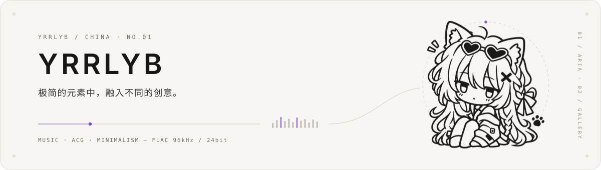
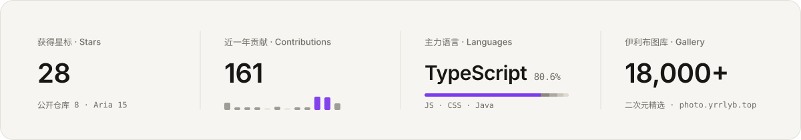

<picture>
  <source media="(prefers-color-scheme: dark)" srcset="./assets/banner-dark.svg" />
  
</picture>

  <a href="https://github.com/YRRLYB/Aria">Aria</a> &nbsp;·&nbsp;
  <a href="https://github.com/YRRLYB/Aria-Mobile">Aria-Mobile</a> &nbsp;·&nbsp;
  <a href="https://photo.yrrlyb.top/api.html">伊利布图库</a> &nbsp;·&nbsp;
  <a href="https://github.com/YRRLYB/Folio">Folio</a> &nbsp;·&nbsp;
  <a href="https://github.com/YRRLYB/Nexus">Nexus</a>

做爱做的，干想干的，这就是我。致力于让自己的兴趣爱好能贡献于同样喜欢的人们。

看不惯各个音乐平台的软件以及差强人意的设计，所以这是我创作 [Aria](https://github.com/YRRLYB/Aria) 的原因。二次元对我来讲在人生中是不可磨灭的一部分，所以我喜欢收集各种二次元美少女的图片，汇集成[图库](https://photo.yrrlyb.top/api.html)，当然我本人也乐意做这种事情。

美学设计上，我个人更偏爱极简的元素中融入不同的创意，在我的项目里都能找到我的理念。坐标拆那。

## 正在做 Now

#### 音乐 Music

 &nbsp;**[Aria](https://github.com/YRRLYB/Aria)** · 本地无损、网易云、QQ 音乐、B站与 YouTube 放一起听的桌面播放器 &nbsp;[GitHub](https://github.com/YRRLYB/Aria) · [Releases](https://github.com/YRRLYB/Aria/releases/latest) 
 &nbsp;**[Aria-Mobile](https://github.com/YRRLYB/Aria-Mobile)** · Aria 的安卓伴侣端，出门也接着同一条队列往下听 &nbsp;[GitHub](https://github.com/YRRLYB/Aria-Mobile)

#### 二次元与内容 ACG & Content

 &nbsp;**[YRRLYB API](https://github.com/YRRLYB/YRRLYB-API)** · 公益性质的二次元美少女图片接口，收录 18,000+ 张图 &nbsp;[photo.yrrlyb.top](https://photo.yrrlyb.top/api.html) · [GitHub](https://github.com/YRRLYB/YRRLYB-API) 
 &nbsp;**[yrr-fortune](https://github.com/YRRLYB/nonebot-plugin-yrr-fortune)** · NoneBot 每日运势卡片插件，六维雷达与六套模板 &nbsp;[GitHub](https://github.com/YRRLYB/nonebot-plugin-yrr-fortune) 
 &nbsp;**[Folio](https://github.com/YRRLYB/Folio)** · 内置 Studio 工作台的自定义博客与作品集 &nbsp;[GitHub](https://github.com/YRRLYB/Folio)

#### 工具 Tools

 &nbsp;**[Nexus](https://github.com/YRRLYB/Nexus)** · 适用于个人的机器连接集成平台 &nbsp;[GitHub](https://github.com/YRRLYB/Nexus) 
 &nbsp;**[Q-gate](https://github.com/YRRLYB/Q-gate)** · 简单轻量的答题框架 &nbsp;[GitHub](https://github.com/YRRLYB/Q-gate)

## 数据 Stats

<picture>
  <source media="(prefers-color-scheme: dark)" srcset="https://raw.githubusercontent.com/YRRLYB/YRRLYB/output/stats-dark.svg" />
  
</picture>

<picture>
  <source media="(prefers-color-scheme: dark)" srcset="https://raw.githubusercontent.com/YRRLYB/YRRLYB/output/github-contribution-grid-snake-dark.svg" />
  
</picture>

做爱做的，干想干的。

